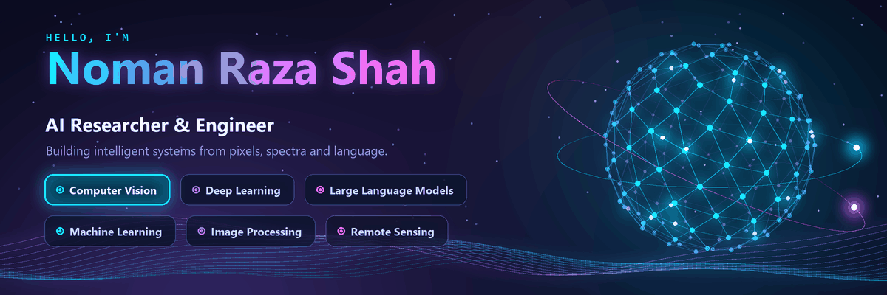

<!-- GitHub profile README | NomanShahRaza -->

### Building intelligent systems from pixels, spectra, and language.

## 👋 About me

I'm **Noman Raza Shah**, an electrical engineer and AI researcher working at the intersection of **computer vision, image processing, machine learning, deep learning, large language models (LLMs), and remote sensing**.

My work spans **applied AI tooling** and **research-oriented algorithm development**, turning ideas into practical, usable software.

- 🔭 **Vision systems:** object detection, segmentation, pose estimation, tracking and visual analytics.
- 🛰️ **Remote sensing:** satellite and aerial imagery analysis, multispectral and hyperspectral data.
- 🧠 **Learning systems:** machine learning, deep neural networks and practical model evaluation.
- 💬 **Language AI:** large language models, natural language processing and text understanding.
- 🧪 **Engineering mindset:** reproducible experiments, usable interfaces and turning research into working software.

## ✨ Featured projects

<table>
<tr>
<td width="50%" valign="top">

### 🎯 [YOLOStudio](https://github.com/NomanShahRaza/yolo-vision-studio)

**Computer vision workspace · Desktop + Web**

Unified inference tooling for YOLO and RT-DETR families, supporting **detection, segmentation, pose estimation, oriented bounding boxes, classification and tracking** on images, video and webcam streams.

`Python` `PyTorch` `Ultralytics` `PySide6` `Flask`

[**View repository →**](https://github.com/NomanShahRaza/yolo-vision-studio)

</td>
<td width="50%" valign="top">

### 🛰️ [HAD Studio](https://github.com/NomanShahRaza/hyperspectral-anomaly-studio)

**Hyperspectral anomaly detection · Research workbench**

Interactive local browser environment for hyperspectral analysis with **22 anomaly detectors**, **5 dimensionality-reduction approaches**, spectrum inspection, overlays and **ROC/AUC evaluation**.

`Python` `Remote Sensing` `Hyperspectral Imaging` `MATLAB / Octave`

[**View repository →**](https://github.com/NomanShahRaza/hyperspectral-anomaly-studio)

</td>
</tr>
<tr>
<td width="50%" valign="top">

### 🔬 [Hyperspectral Anomaly Detection Algorithms](https://github.com/NomanShahRaza/hyperspectral_anomaly_detection_algorithms)

**Algorithms · Research collection**

A research-oriented catalogue of hyperspectral anomaly detection techniques, spanning statistical, representation-based and other classical approaches, with references to supporting resources.

`Anomaly Detection` `Spectral Analysis` `Research`

[**Explore algorithms →**](https://github.com/NomanShahRaza/hyperspectral_anomaly_detection_algorithms)

</td>
<td width="50%" valign="top">

### 🌍 [Hyperspectral Anomaly Datasets](https://github.com/NomanShahRaza/hyperspectral_anomaly_datasets)

**Remote sensing · Benchmark resources**

Curated hyperspectral scenes and dataset references for reproducing experiments, comparing detectors and exploring anomaly detection benchmarks.

`Datasets` `Evaluation` `Remote Sensing`

[**Explore datasets →**](https://github.com/NomanShahRaza/hyperspectral_anomaly_datasets)

</td>
</tr>
</table>

## 🧰 Technical toolbox

  

**AI / Deep Learning**

## 🔎 Areas of interest

## 📄 Research

I enjoy working on **any problem across AI, computer vision, image processing, machine learning, deep learning, LLMs and remote sensing**, from early research and experimentation to building practical, reliable tools that people can actually use. Whether it's a research idea, a prototype or a production-ready application, I'm always keen to take on new challenges in the field.

## 📊 GitHub Stats

  <b>🐍 Contribution calendar</b>  
  <picture>
    <source media="(prefers-color-scheme: dark)" srcset="https://raw.githubusercontent.com/NomanShahRaza/NomanShahRaza/output/github-snake-dark.svg" />
    <source media="(prefers-color-scheme: light)" srcset="https://raw.githubusercontent.com/NomanShahRaza/NomanShahRaza/output/github-snake.svg" />
    
  </picture>

  
  

  

  

## 📫 Contact me

I'm open to research collaborations, AI projects and interesting conversations. Feel free to reach out!

---

### Let's build AI systems that make research useful.

[**Explore all repositories**](https://github.com/NomanShahRaza?tab=repositories) · [**YOLOStudio**](https://github.com/NomanShahRaza/yolo-vision-studio) · [**HAD Studio**](https://github.com/NomanShahRaza/hyperspectral-anomaly-studio)

Research • Experimentation • Engineering

